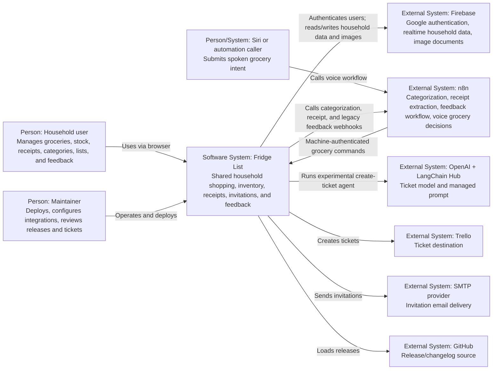
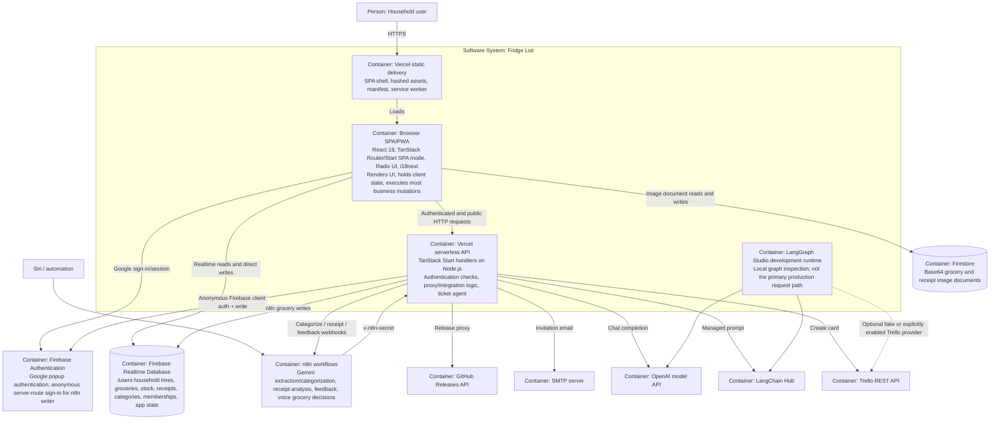
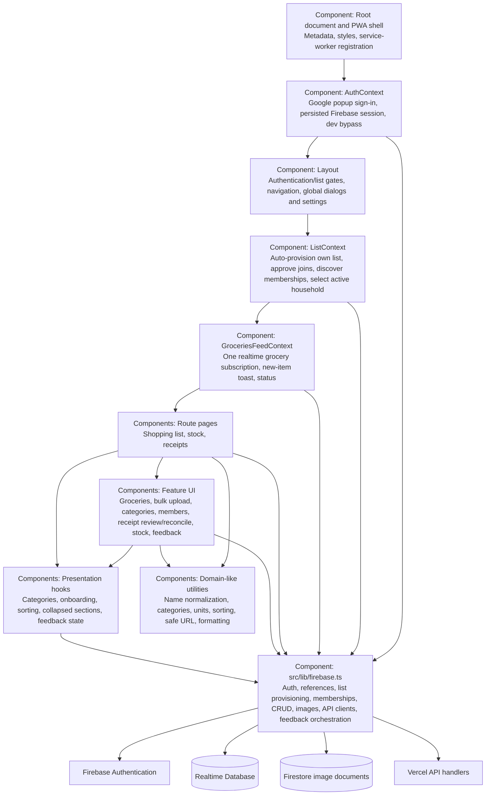
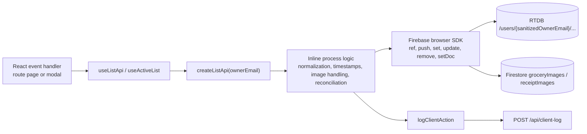
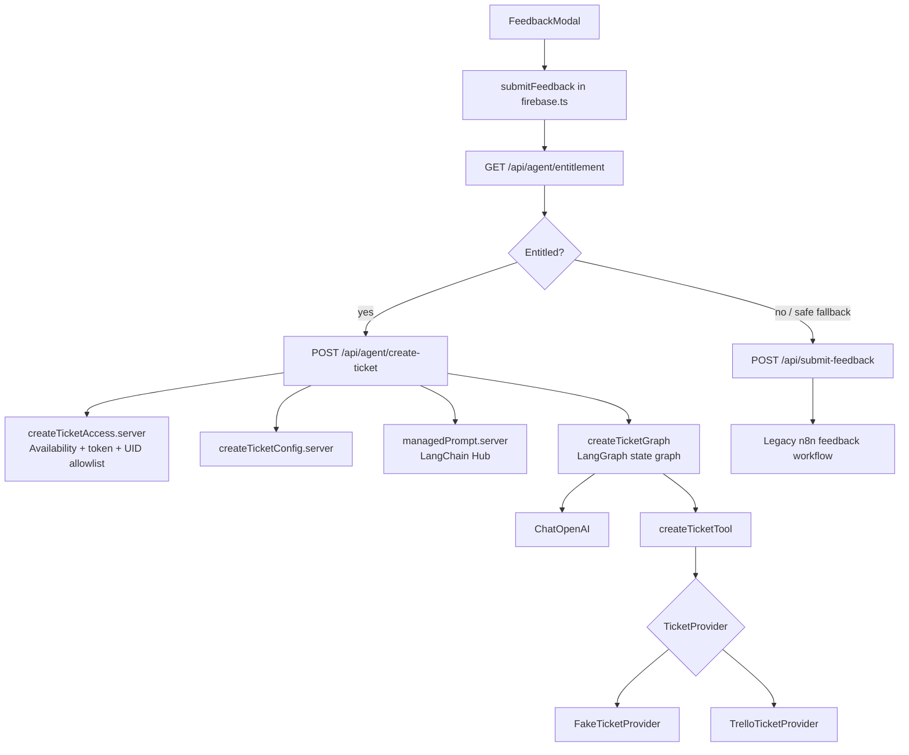
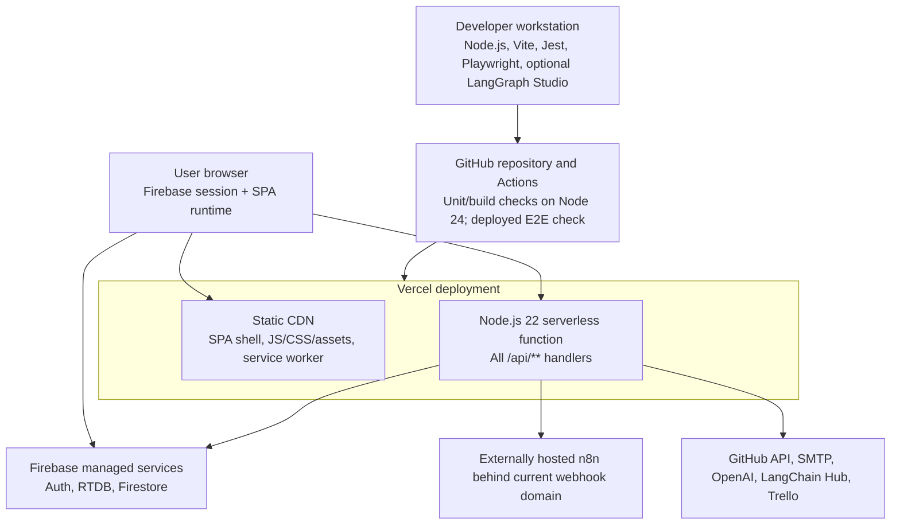

# C4 Architecture Model: Current Fridge List System

Target-state companion: `c4-target-architecture.md`

Status: Current-state reconstruction
Observed from: repository source and configuration
Scope: deployed application, browser runtime, server APIs, Firebase, automations, and ticketing integrations

## 1. Purpose and modeling boundary

This document reconstructs the system that exists today. It does not describe the proposed modular-monolith target.

The repository builds one TanStack Start application, but the runtime is not a self-contained monolith. Business behavior is distributed across:

- a React SPA/PWA in the browser;
- TanStack Start API handlers deployed as one Vercel serverless function;
- Firebase Authentication, Realtime Database, and Firestore;
- n8n workflows exposed through webhook endpoints;
- OpenAI/LangChain/LangGraph ticket orchestration;
- Trello, SMTP, and GitHub integrations.

### C4 element legend

| Element | Meaning in this model |
| --- | --- |
| Person | A human actor using or operating the system |
| Software system | Independently operated external or in-scope system |
| Container | Separately running/deployed application or datastore |
| Component | A cohesive runtime responsibility inside a container |
| Code view | Important source-level dependencies inside a component |

## 2. Level 1 — System Context

### Context observations

- Fridge List depends on n8n in both directions: the application calls n8n, and n8n calls the application.
- Firebase is part of the application's live trust boundary because the browser accesses it directly.
- Ticket creation has two production paths: the experimental in-process agent and the legacy n8n feedback workflow.

## 3. Level 2 — Container Model

### Deployment characteristics

- `tanstackStart({ spa: { enabled: true } })` produces a static SPA shell plus server output for APIs.
- `scripts/build.mjs` force-terminates a successful build because importing the browser Firebase module during prerender opens a persistent RTDB connection.
- `scripts/vercel-build.mjs` manually assembles Vercel Build Output API v3: static assets plus one Node.js 22 serverless function for `/api/**`.
- The browser document routes are served by the static shell; API routes are sent to the serverless function.

## 4. Level 3 — Browser SPA Components

### Browser component responsibilities

| Component | Current responsibility |
| --- | --- |
| `AuthContext` | Resolves Firebase Auth state and exposes Google sign-in/sign-out |
| `ListContext` | Provisions a list, converts pending membership to joined, subscribes to membership records, constructs the active `ListApi` |
| `GroceriesFeedContext` | Maintains the shared active-list groceries subscription |
| Shopping page | Grocery grouping, filtering, sublists, purchased workflow, category moves, stock suggestion |
| Stock page | Stock subscription, quantity and threshold operations, add-to-grocery workflow |
| Receipts page | Receipt subscription, scan/review/save/delete/reconcile workflow, price history |
| `src/lib/firebase.ts` | The dominant client gateway and process implementation; it combines authentication, database access, image storage, API calls, logging, and business rules |

## 5. Level 3 — Server API Components

```mermaid
flowchart TB
  Router["Component: TanStack Start API routing\n10 current API routes"]
  UserAuth["Component: verifyAuthToken\nCustom JOSE verification against Firebase JWKS"]
  MachineAuth["Component: n8n shared-secret check\nx-n8n-secret"]
  Logger["Component: consola logger"]

  Categorize["Component: Categorize route\nAuthenticated proxy to n8n"]
  ReceiptFile["Component: Receipt file route\nAuthenticated base64 proxy to n8n"]
  ReceiptURL["Component: Receipt URL route\nAuthenticated URL fetch/scrape + n8n proxy"]
  Feedback["Component: Feedback route\nAuthenticated legacy n8n/Trello workflow proxy"]
  Releases["Component: Releases route\nAuthenticated GitHub proxy"]
  Invite["Component: Invitation-email route\nValidation + SMTP; currently unauthenticated"]
  ClientLog["Component: Client-log route\nSanitized arbitrary message ingestion; currently unauthenticated"]
  N8NWriter["Component: n8n grocery writer\nMachine secret, anonymous Firebase sign-in, hard-coded household, low-level insert/update"]
  Entitlement["Component: Ticket entitlement\nEnvironment/UID allowlist and concealment"]
  TicketRoute["Component: Create-ticket route\nValidation, configuration, prompt, model, provider orchestration"]
  TicketGraph["Component: LangGraph ticket agent\nStructured workflow and tool call"]
  Providers["Components: Ticket providers\nTrello and fake implementations"]

  N8N["n8n webhooks"]
  GitHub["GitHub API"]
  SMTP["SMTP"]
  RTDB[("Firebase RTDB")]
  FirebaseAuth["Firebase Authentication"]
  OpenAI["OpenAI"]
  Hub["LangChain Hub"]
  Trello["Trello"]

  Router --> Categorize & ReceiptFile & ReceiptURL & Feedback & Releases & Invite & ClientLog & N8NWriter & Entitlement & TicketRoute
  Categorize & ReceiptFile & ReceiptURL & Feedback & Releases --> UserAuth
  Entitlement & TicketRoute --> UserAuth
  N8NWriter --> MachineAuth
  Categorize & ReceiptFile & ReceiptURL & Feedback --> N8N
  Releases --> GitHub
  Invite --> SMTP
  N8NWriter --> FirebaseAuth
  N8NWriter --> RTDB
  TicketRoute --> TicketGraph
  TicketRoute --> Hub
  TicketGraph --> OpenAI
  TicketGraph --> Providers
  Providers --> Trello
  Categorize & ReceiptFile & ReceiptURL & Feedback & Releases & Invite & ClientLog & N8NWriter & Entitlement & TicketRoute --> Logger
```

### Current route inventory

| Method | Route | Primary responsibility | Authentication today |
| --- | --- | --- | --- |
| `POST` | `/api/categorize-item` | Proxy item text to n8n categorization | Firebase bearer token |
| `POST` | `/api/client-log` | Write sanitized client message to server logs | None |
| `POST` | `/api/n8n-write-groceries` | Execute low-level grocery insert/reactivate command | Shared machine secret |
| `GET` | `/api/releases` | Fetch normalized GitHub releases | Firebase bearer token |
| `POST` | `/api/scan-receipt` | Proxy base64 receipt to n8n | Firebase bearer token |
| `POST` | `/api/scan-receipt-url` | Fetch URL, extract target, proxy to n8n | Firebase bearer token |
| `POST` | `/api/send-invite-email` | Deliver SMTP invitation | None |
| `POST` | `/api/submit-feedback` | Send feedback to legacy n8n flow | Firebase bearer token |
| `GET` | `/api/agent/entitlement` | Determine experimental ticket entitlement | Firebase bearer token when endpoint is available |
| `POST` | `/api/agent/create-ticket` | Run experimental ticket agent | Firebase bearer token + feature/UID policy |

## 6. Level 4 — Browser Mutation Code View

This view shows the current path for a typical grocery or stock mutation. The authoritative write does not cross a server application-service boundary.

### Consequences

- Firebase Rules, not server application services, are the final authorization enforcement point for most product mutations.
- UI, process orchestration, persistence, and transport concerns are coupled through `src/lib/firebase.ts` and page handlers.
- Multi-step operations such as receipt reconciliation can partially complete.
- Email-derived household keys are both identity and physical storage paths.

## 7. Level 4 — Feedback and Ticket Code View

## 8. Deployment Model

## 9. Architectural Reconstruction Summary

### What the system is today

The current architecture is a hybrid client-heavy distributed application:

- one source repository and one primary Vercel deployment;
- browser-owned application processes and Firebase writes;
- thin-to-thick server route handlers for integrations;
- externally owned n8n business workflows;
- managed Firebase datastores and identity;
- a separately structured experimental ticket-agent subsystem.

It is not yet a modular monolith in the architectural sense because there is no single server-side application boundary that owns business mutations, authorization, and module contracts.

### Dominant structural seams

1. **Identity and households:** Google/Firebase user identity maps to email-derived RTDB household keys and mirrored invitation pointers.
2. **List-scoped client gateway:** `createListApi()` binds the active household and exposes groceries, stock, receipts, categories, images, and reconciliation.
3. **Integration APIs:** TanStack route files independently implement authentication, validation, provider calls, logging, and response mapping.
4. **Automation boundary:** n8n owns several extraction and grocery-decision workflows.
5. **Ticketing boundary:** the experimental LangGraph agent already has comparatively clear schemas, provider ports, access policy, and tests.

### Highest-risk coupling

| Coupling | Evidence | Architectural effect |
| --- | --- | --- |
| Build imports live Firebase client module | `scripts/build.mjs`, `src/lib/firebase.ts` | Successful builds require forced process termination |
| Browser directly mutates RTDB/Firestore | `createListApi`, list/invite helpers | Server cannot centrally authorize or enforce business invariants |
| Email is identity and physical list key | `sanitizeEmailKey`, `/users/{key}` | Collision and email-change risks affect authorization and storage |
| Route files own provider orchestration | `src/routes/api/**` | Repeated authentication/error logic and poor use-case isolation |
| n8n owns grocery decisions | n8n command contract and hard-coded target | Domain behavior exists outside the repository |
| One client facade spans most domains | `src/lib/firebase.ts` | Changes cross module boundaries and complicate testing |
| Hand-built Vercel packaging | `scripts/vercel-build.mjs` | Deployment depends on framework-integration workarounds |

## 10. Validation Checklist

The model should be updated whenever one of these facts changes:

- browser Firebase writes are removed;
- household identity stops using sanitized email keys;
- a server application-service/module layer is introduced;
- n8n's ownership of grocery decisions changes;
- Firestore image persistence changes;
- the Vercel deployment adapter is replaced;
- feedback no longer has dual agent/n8n paths;
- API authentication policy changes.
