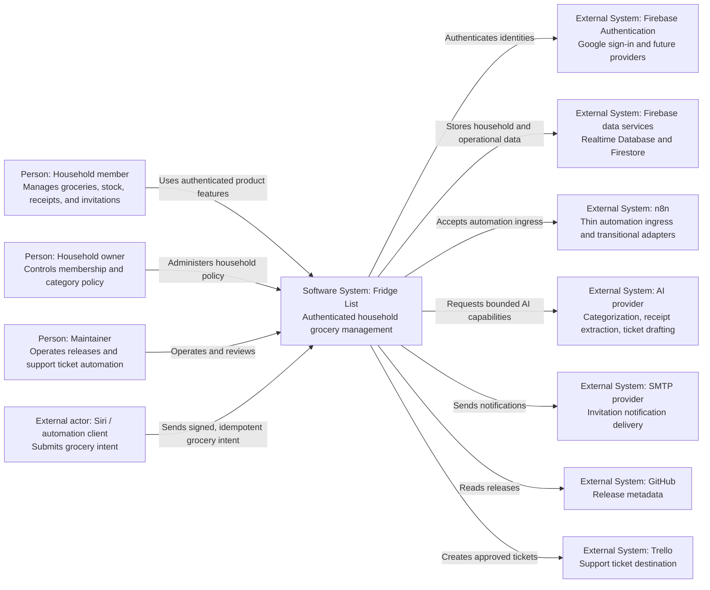
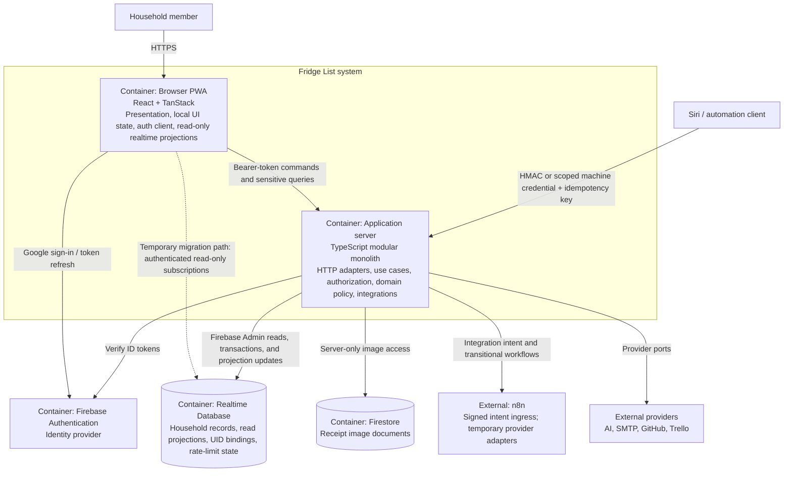
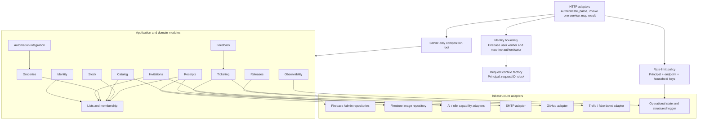
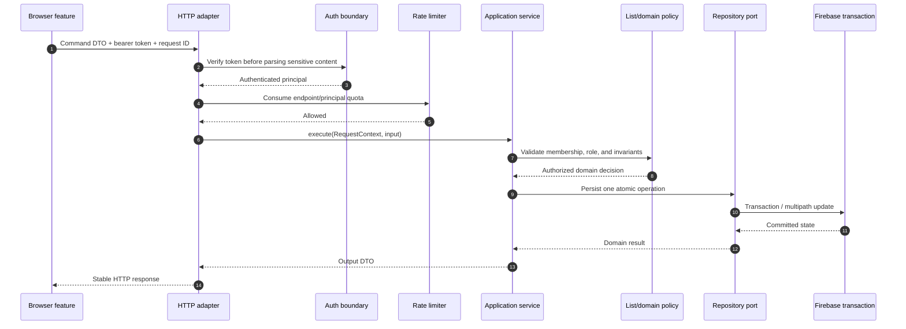
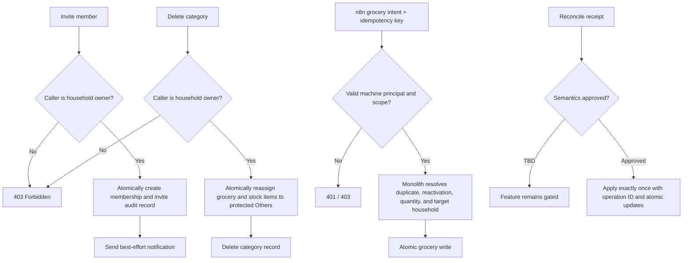
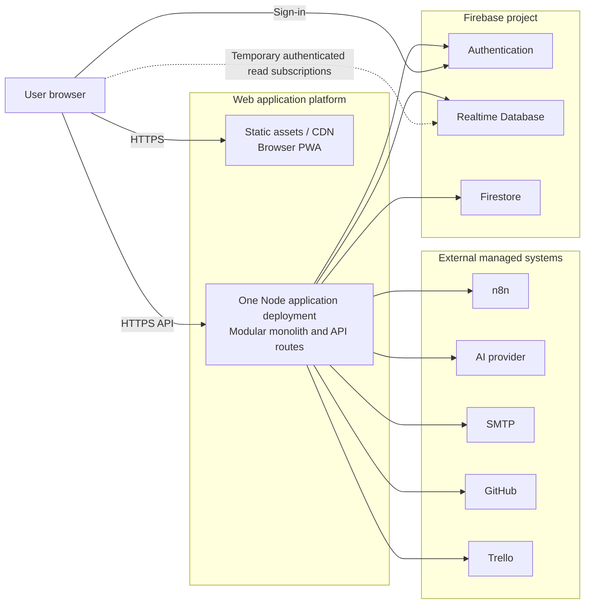

# C4 Architecture Model: Target Fridge List System

Status: Proposed
Architecture: Authenticated modular monolith
Companion documents: `c4-current-architecture.md`, `spec-modular-monolith.md`

## 1. Recommended Architecture

Build one server-side modular monolith and keep the browser as a presentation client. Every command crosses the authenticated server boundary. During migration, the browser may retain direct Firebase subscriptions for read-only realtime projections, but it must not write business data directly.

This is intentionally an evolutionary architecture:

- Keep React, TanStack Router/Start, Firebase Authentication, RTDB, Firestore, and the current public URLs for the first migration.
- Replace the browser-owned business layer and route-owned workflows with module-owned application services.
- Use Firebase Admin on the server for token verification, authorization data, transactions, and persistence.
- Reduce n8n to an integration edge. It submits authenticated intent; the monolith owns grocery decisions, deduplication, reactivation, and household policy.
- Put AI, SMTP, GitHub, Trello, Firebase, and n8n behind provider or repository ports so they can change independently.
- Prefer a standard framework deployment adapter. The current forced-exit build and hand-built serverless bundle are migration liabilities, not target components.

The target is not microservices. Modules are ownership and dependency boundaries inside one deployable application.

### C4 alignment

The sections below align directly with the current-state model:

| C4 level | Current model | Target model |
| --- | --- | --- |
| Level 1 | Users and integrations reach a mixed browser/server system | The same actors reach one explicitly authenticated product boundary |
| Level 2 | Browser, API routes, and Firebase each own business behavior | Browser presents and reads; the modular monolith owns commands and policy |
| Level 3 browser | `firebase.ts` is a client-side business facade | Feature UI uses an API client and a read-only realtime adapter |
| Level 3 server | Ten route-specific workflows | Thin HTTP adapters invoke domain-owned services through a composition root |
| Level 4 mutations | Browser code writes Firebase directly | Authenticated application services authorize and transact through ports |
| Level 4 feedback/tickets | Two competing submission paths | One ticketing/feedback policy with replaceable providers |
| Deployment | Custom Vercel packaging and forced build exit | One standard web deployment plus managed Firebase and external providers |

## 2. Level 1 — System Context



### Context decisions

- Registration is open and Google sign-in is supported.
- Product content is sign-in-only; a public HTML shell may still load before the Firebase session resolves.
- An accepted invitation immediately grants household access.
- Identity is keyed by Firebase UID. Email is contact and discovery data, never the long-term aggregate key.
- The modular monolith, not n8n or the browser, owns business decisions.

## 3. Level 2 — Container Model



### Container responsibilities

| Container | Owns | Must not own |
| --- | --- | --- |
| Browser PWA | Rendering, accessibility, navigation, ephemeral UI state, token acquisition, read subscriptions | Authorization, household mutation rules, provider credentials, direct business writes |
| Application server | Authentication boundary, authorization, validation, orchestration, transactions, rate limits, provider normalization | Browser state or provider-specific concepts in domain code |
| Firebase Authentication | Identity proof and token issuance | Household roles or application entitlements |
| Realtime Database | Durable household state and read projections | Business decisions encoded only in security rules |
| Firestore | Receipt image persistence behind a repository | Direct browser image ownership in the target state |
| n8n | External workflow transport and optional transitional provider adapter | Grocery/category/receipt policy |

The direct browser-to-RTDB read edge is a deliberate migration compromise. Firebase rules must make it read-only for application collections. The long-term option is to move reads behind server query APIs if operational needs outweigh native realtime behavior.

## 4. Level 3 — Browser PWA Components

```mermaid
flowchart LR
  Shell["App shell and router"]
  Identity["Identity client<br/>Google sign-in, token refresh, session state"]
  GroceryUI["Grocery feature UI"]
  StockUI["Stock feature UI"]
  ReceiptUI["Receipt feature UI"]
  HouseholdUI["Household, invitation, and category UI"]
  SupportUI["Feedback and release UI"]
  Commands["Typed command/query API client<br/>Attaches current ID token and request ID"]
  ReadModel["Read-only realtime adapter<br/>Maps RTDB snapshots to view models"]
  Local["Local presentation services<br/>i18n, notifications, PWA cache"]

  Shell --> Identity
  Shell --> GroceryUI & StockUI & ReceiptUI & HouseholdUI & SupportUI
  GroceryUI & StockUI & ReceiptUI & HouseholdUI & SupportUI --> Commands
  GroceryUI & StockUI & ReceiptUI & HouseholdUI --> ReadModel
  GroceryUI & StockUI & ReceiptUI & HouseholdUI & SupportUI --> Local
  Identity --> Commands
  Identity --> ReadModel
```



### Browser rules

- There is no replacement for the current all-purpose `src/lib/firebase.ts` facade.
- Feature components call use-case-oriented API methods such as `addGroceryItems`, `inviteMember`, or `reconcileReceipt`.
- The realtime adapter exports queries/view models only. It cannot expose Firebase mutation primitives.
- The API client handles token attachment, request IDs, bounded retries for safe requests, and typed error mapping.
- UI components never decide whether a user owns a list or may delete a category; they only adapt the server result.

## 5. Level 3 — Application Server Components



### Module ownership and public contracts

| Module | Primary aggregate or policy | Representative services |
| --- | --- | --- |
| Identity | Verified principal and UID binding | `AuthenticateUser`, `AuthenticateMachine`, `BindIdentity` |
| Lists | Household/list membership and roles | `EnsureOwnList`, `GetAccessibleLists`, `RequireListRole` |
| Groceries | Grocery lifecycle and purchase state | `AddGroceryItems`, `UpdateGroceryItem`, `SetPurchased`, `DeleteGroceryItem` |
| Catalog | Categories, normalization, fallback policy | `CategorizeItem`, `CreateCategory`, `DeleteCategoryAndReassign` |
| Stock | Inventory quantity and thresholds | `CreateStockItem`, `UpdateStockItem`, `SuggestStockForGrocery` |
| Receipts | Scanning, storage, and reconciliation | `ScanReceipt`, `SaveReceipt`, `ReconcileReceipt` |
| Invitations | Invite lifecycle and notifications | `InviteListMember`, `RemoveListMember`, `SendInvitationNotification` |
| Feedback | User feedback intake | `SubmitFeedback` |
| Releases | Product release projection | `GetReleases` |
| Observability | Bounded structured client events | `RecordClientEvent` |
| Ticketing | Entitlement, drafting, approval, submission | `GetTicketEntitlement`, `CreateTicket` |
| Integration | Machine ingress and intent normalization | `WriteGroceriesFromIntegration` |

The `Lists` module exposes access-policy contracts to other modules. Other modules do not query its Firebase paths directly. Cross-module imports use public `index.ts` APIs and may not deep-import internal application, domain, or infrastructure files.

## 6. Level 4 — Authenticated Command Flow



### Command invariants

- Authentication occurs before business payload processing or logging.
- Authorization is repeated at the application-service boundary and is based on verified UID plus repository state.
- A route invokes exactly one top-level application service.
- Application services accept `RequestContext` and transport-neutral DTOs; they do not accept `Request` or return `Response`.
- Mutation retries require an idempotency key where duplicate side effects are possible.
- Provider failures are normalized to typed application errors before HTTP mapping.
- Logs contain request IDs and safe identifiers, not tokens, receipt content, prompts, or raw upstream bodies.

## 7. Level 4 — Critical Business Workflows



### Business decisions preserved

- Invitations grant access immediately after the authorized server transaction; email delivery does not control access.
- Category management is owner-only in the proposed policy.
- `Others` is a protected per-household fallback. Existing storage key `other` and display label `אחר` remain compatible during migration.
- n8n remains single-household initially but does not own grocery decisions. Multi-household support requires explicit machine-to-household bindings and scoped credentials.
- Receipt reconciliation remains disabled until its exact domain semantics are approved. The recommended implementation is exactly-once per receipt with an operation ID and atomic updates.

## 8. Deployment Model



### Deployment rules

- The server is one deployable unit regardless of whether it runs as a serverless function or a long-lived Node process.
- Server configuration and credentials are injected only into the composition root.
- No server import may initialize a live Firebase client connection during build or prerender.
- Build completion must be natural; the forced process termination is removed.
- RTDB security rules enforce authenticated read projections and deny client writes to server-owned collections.
- Emulator-backed integration tests validate Auth, RTDB rules, transactions, and UID migration behavior.

## 9. Current-to-Target Crosswalk

| Current element or behavior | Target owner | Migration action |
| --- | --- | --- |
| `src/lib/firebase.ts` owns auth, data, images, API calls, and rules | Browser identity/read adapters plus server domain modules | Split by capability; do not create a new shared god facade |
| Browser mutates RTDB/Firestore | Application services and Firebase Admin repositories | Add command APIs, migrate one use case at a time, then deny client writes |
| Sanitized email is the household key | Lists/Identity modules | Add UID and opaque list-ID bindings without breaking existing paths; migrate reads before keys |
| Route files own workflows and providers | Thin HTTP adapters | Move orchestration into services and construction into `composition.server.ts` |
| Custom JOSE verification | Identity infrastructure adapter | Use the supported Firebase Admin token verifier and normalize claims |
| Unauthenticated client log and invitation email | Observability and Invitations services | Require user context, authorize, sanitize, bound, and rate-limit |
| n8n hard-codes household and writes decisions | Integration service | Accept signed intent plus idempotency key; apply grocery policy server-side |
| n8n categorization/receipt logic is a hidden domain dependency | Catalog/Receipts provider ports | Keep n8n as a temporary adapter or replace it without changing services |
| Two feedback/ticket paths | Feedback and Ticketing modules | Select one product workflow and retire the duplicate after compatibility rollout |
| Browser accesses Firestore receipt images | Receipts image repository | Add authenticated server endpoints and remove client persistence access |
| Manual serverless packaging and forced build exit | Standard application deployment | Remove import-time side effects, then adopt the framework-supported deployment path |
| Ad hoc limits and logs | Shared operational adapters | Add durable rate-limit state and structured, minimized observability |

## 10. Proposed Source Structure

```text
src/
  client/
    api/                    # typed authenticated API client
    identity/               # Firebase browser auth only
    read-model/             # read-only realtime projections
    presentation/           # shared UI concerns
  modules/
    identity/
    lists/
    groceries/
    catalog/
    stock/
    receipts/
    invitations/
    feedback/
    releases/
    observability/
    ticketing/
    integration/
    shared/                 # context, errors, clock, IDs only
  server/
    composition.server.ts   # the only dependency construction root
    http/                   # auth handlers, parsing, error mapping, rate limiting
  routes/
    api/                    # thin route adapters
    __root.tsx
    index.tsx
    stock.tsx
    receipts.tsx
```

Each business module uses the same internal shape where needed:

```text
<module>/
  domain/                   # policies, entities, value objects, repository ports
  application/              # authenticated use-case services and DTOs
  infrastructure/           # Firebase/provider adapters
  presentation/             # optional module-owned React components/hooks
  index.ts                   # public module contract
```

Folders are earned by real responsibilities; trivial modules do not need empty layers.

## 11. Architecture Fitness Tests

The architecture is accepted only when automated checks prove:

1. Browser production code cannot import Firebase mutation functions or server modules.
2. Route files cannot import Firebase SDKs, provider SDKs, SMTP, n8n clients, or domain internals.
3. Domain and application code cannot import TanStack, browser globals, or provider SDKs.
4. Cross-module imports use each module's public entry point.
5. Every application service requires an authenticated `RequestContext`.
6. Rejected authentication requests do not parse sensitive payloads or trigger side effects.
7. Authorization tests cover owner, member, non-member, and machine-scope cases.
8. RTDB rules deny browser writes after each migrated collection is cut over.
9. Contract tests preserve public URLs, success shapes, and deliberate authentication changes.
10. The generated route inventory and C4 route map remain synchronized.

## 12. Recommended Migration Slices

1. **Foundation:** add RequestContext, Firebase Admin verification, typed errors, HTTP mapping, composition root, and dependency checks.
2. **Low-risk API extraction:** releases, observability, categorization, and feedback become thin routes over services.
3. **Identity and household model:** add UID/list-ID bindings and owner/member policies while retaining compatible Firebase paths.
4. **Server-owned commands:** migrate groceries, categories, stock, invitations, and receipts one vertical slice at a time.
5. **Read projection hardening:** expose a read-only browser adapter and deny client writes for migrated collections.
6. **Integration ownership:** move n8n grocery decisions into the Integration and Groceries modules; add idempotency and then HMAC.
7. **Sensitive data boundary:** move receipt images fully behind server APIs.
8. **Deployment cleanup:** remove Firebase import-time side effects, forced build termination, and manual packaging where the selected framework adapter supports the deployment.
9. **Compatibility removal:** delete the old facade and route logic only after telemetry and contract tests show no remaining callers.

Each slice must leave the application deployable and reversible. Data-key migration is additive until all readers and rollback windows are complete.

## 13. Deliberate Decision Gates

These do not block the foundation, but they block their specific feature slice:

- Receipt reconciliation: exact state transitions, quantities, stock effects, duplicate scans, and rollback behavior.
- n8n HMAC timing: recommended after centralized machine authentication and before adding more households or integrations.
- Additional sign-in providers: identity ports stay provider-neutral; Google remains the only committed provider now.
- Concrete rate limits: configure per endpoint after collecting baseline traffic, with conservative bootstrap limits and explicit operational overrides.
