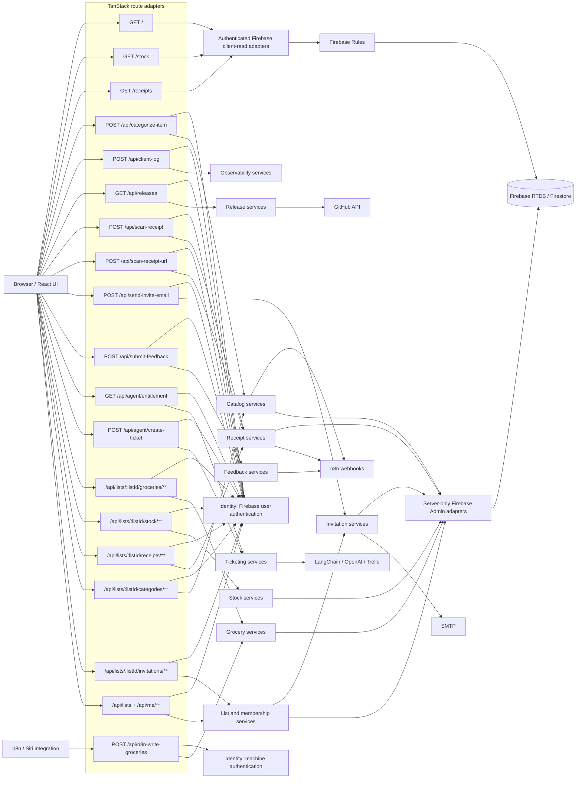

# Spec: Authenticated Modular Monolith

Status: Draft v4 — architecture challenged and phased execution plan added
Language: TypeScript
Framework: TanStack Start / React
Architecture: Modular monolith

## 1. Goal

Refactor the application into a modular monolith in which every business process is implemented by an application service, every API handler is a thin adapter, and every available HTTP service authenticates its caller before executing validation, external calls, persistence, or other side effects.

The refactor must preserve the current user-facing behavior and existing public route URLs while making module ownership, dependencies, authentication, and testing explicit. New authenticated mutation routes may be added because authoritative business mutations are moving from browser-to-Firebase calls to server APIs.

## 1.1 Future-agent execution contract

This document is the architectural and business source of truth. Trello records execution status; a Trello card must not silently override this specification.

Before changing code, every future agent must read, in order:

1. This specification in full.
2. `c4-current-architecture.md` to understand the behavior and coupling being replaced.
3. `c4-target-architecture.md` to understand the intended dependency direction and deployment boundary.
4. `context7-architecture-audit.md` for the current framework and SDK decisions.
5. The selected Trello `[MM][NN]` card, including its dependencies and acceptance criteria.

Execution rules:

- Work on one Trello card or one explicitly bounded subset of a card at a time. Do not attempt the entire refactor in one change set.
- Inspect the working tree before editing. Existing modifications belong to the user or another task and must be preserved.
- A `sync` card changes shared paths, security, data bindings, or rollout state. Only one overlapping `sync` card may be in progress at a time.
- An `async` card may be assigned to an independent agent only when its dependencies are complete and its file ownership does not overlap another active task.
- Prefer public module contracts and additive compatibility adapters. Do not add new behavior to `src/lib/firebase.ts` or another temporary facade.
- Preserve public browser routes, API URLs, Firebase domain-data paths, and response contracts unless this specification explicitly approves the change.
- Use Context7 for current library/framework APIs before changing TanStack Start, Firebase, Vite, React, LangChain, or deployment configuration.
- Do not treat an open decision as approved. A blocked feature slice remains gated while independent slices continue.
- If implementation evidence contradicts this specification, stop that slice, document the conflict, and update the spec or obtain an owner decision before proceeding.
- Move a card to `In Progress` only when work actually starts. Move it to `Done` only after its acceptance criteria and required verification pass; otherwise record the remaining blocker.

Definition of ready:

- The card has one milestone label, one importance label, and one execution label.
- Its required dependencies are complete or explicitly mocked behind stable ports.
- Its product decisions are resolved, or the card is itself the decision task.
- Its expected files and compatibility boundary are understood.

Definition of done:

- The card's development scope and acceptance criteria are satisfied.
- Relevant unit, contract, authorization, architecture, and build checks pass.
- No unrelated user changes were overwritten.
- C4/route documentation is updated when the component or route inventory changes.
- Compatibility code removed by the card has no remaining callers.
- Trello contains a concise completion note with verification evidence and any follow-up risk.

## 1.2 Confirmed product and architecture decisions

1. **Server-owned mutations.** Every authoritative business mutation runs through an authenticated server API and application service. The browser must not write business data directly to Firebase after its migration slice is complete.
2. **Open registration.** Any eligible user may register; an invitation is not required to create a household. Google sign-in remains a supported sign-in option. Adding other identity providers is not part of this refactor.
3. **Sign-in-only application.** The shopping-list, stock, and receipt experiences require an authenticated user. There is no anonymous or read-only application mode.
4. **Invitation grants access immediately.** Creating an invitation immediately grants the invited identity access to the household. Recipient sign-in records onboarding/join status; it does not activate authorization.
5. **Category deletion reassigns products.** Deleting an unprotected category reassigns all grocery and stock products using it to that household's protected fallback category, referred to in this spec as `Others` (current key `other`, current display name `אחר`).
6. **Receipt reconciliation idempotency is TBD.** The business owner has not yet decided whether reconciliation must provide exactly-once effects. This is a blocking decision for the final reconciliation contract, not permission to ship an unsafe implicit behavior.
7. **n8n ownership is TBD.** The target decision is whether n8n remains a single-household workflow owner or becomes a thin intent adapter while the monolith owns deduplication, reactivation, and skipping. The recommended target is documented in section 4.6 but is not accepted until the business owner confirms it.

## 2. Architectural principles

1. **One deployable application, explicit modules.** The project remains a single TanStack Start application and deployment. It is not split into microservices.
2. **Routes are adapters.** Route files may parse transport details, call authentication middleware, invoke one application service, and map the service result to HTTP. They must not contain business rules, database operations, email delivery, model orchestration, or third-party API calls.
3. **Every process is a service.** User actions and background/integration workflows are represented by named application services with an `execute` method or equivalent single use-case entry point.
4. **Authentication precedes work.** Every available `/api/**` endpoint must establish an authenticated principal before body parsing beyond transport necessities, business validation, persistence, logging of user content, or upstream calls. A non-sensitive availability/concealment guard may return `404` before authentication for the experimental ticket endpoints, preserving their current rollout policy.
5. **Authorization belongs at the use-case boundary.** Application services require an authenticated context and enforce role, ownership, list membership, entitlement, or integration scope before mutation or sensitive reads.
6. **Dependencies point inward.** Routes and infrastructure depend on application/domain contracts. Domain code must not import TanStack Router, Firebase SDKs, Nodemailer, LangChain, Trello, GitHub, n8n, or browser globals.
7. **Modules communicate through public contracts.** Cross-module imports use the owning module's public entry point, not its internal files.
8. **No distributed-system ceremony.** In-process calls are normal function calls. Do not add queues, service discovery, network calls between modules, or separate deployments.
9. **The server is the mutation trust boundary.** Firebase Admin repositories are server-only. Client code may retain authenticated read subscriptions during an explicitly bounded compatibility phase, but Firebase security rules remain mandatory and all business writes move behind server APIs.
10. **Authenticate business use cases, not pure functions.** Authentication adapters create trusted execution contexts. Every top-level business use case requires one; pure domain policies and subordinate functions do not receive fabricated principals.

## 3. Scope

### In scope

- Refactor every current API route into a thin authenticated adapter.
- Move route processing into module-owned application services.
- Split the current `src/lib/firebase.ts` responsibilities into domain modules and infrastructure adapters.
- Move all authoritative business mutations from browser Firebase calls to authenticated server APIs.
- Add server-side Firebase Admin repositories and authorization reads.
- Require a trusted authenticated context in every top-level business application service.
- Support both user authentication and machine-to-machine authentication.
- Preserve all current browser and API URLs.
- Preserve existing household domain-data paths and record compatibility. Additive server-owned identity-binding and operational metadata are permitted as defined below; no bulk grocery, stock, receipt, or category migration is required.
- Preserve response bodies and status codes unless this spec explicitly changes authentication behavior.
- Preserve existing real-time read behavior during migration; replacing client subscriptions with polling, SSE, or WebSockets is not required by this refactor.
- Add module-level unit tests, route contract tests, dependency-boundary tests, and authentication tests.
- Document the full route map and module dependencies.

### Out of scope

- Creating independently deployed microservices.
- Changing the Firebase data model or migrating existing data.
- Replacing Firebase, n8n, Trello, GitHub, SMTP, LangChain, or OpenAI providers.
- Adding new product functionality, except the explicit behavior, integrity, and security changes approved in this specification.
- Adding sign-in providers beyond the existing Google option.
- Redesigning the UI.
- Changing the existing experimental create-ticket agent's production rollout policy.
- Introducing persistent queues or an event broker.

## 4. Authentication model

“All services are authenticated” means every externally callable HTTP endpoint and every top-level business application-service invocation has a verified principal. Authentication adapters create the context and are exempt from requiring a pre-existing authenticated context.

### 4.1 Principal types

```ts
type UserPrincipal = {
  kind: 'user'
  uid: string
  email: string | null
  emailVerified: boolean
}

type ServicePrincipal = {
  kind: 'service'
  serviceId: string
  scopes: ReadonlySet<string>
  allowedListIds: ReadonlySet<string>
}

type AuthenticatedPrincipal = UserPrincipal | ServicePrincipal

type RequestContext = {
  principal: AuthenticatedPrincipal
  requestId: string
  now: Date
}
```

Top-level business application services must require `RequestContext`; it must not be optional. No service may construct or infer identity from request-body fields. UID is the immutable account identity. Verified normalized email is used only to establish or update the additive legacy binding described below; it is not re-derived on every request as household authority.

### 4.2 User authentication

- Browser-facing APIs use the existing Firebase ID token in `Authorization: Bearer <token>`.
- A shared authentication adapter verifies the token and creates a `UserPrincipal`.
- Registration is open and Google sign-in remains supported. Sign-in is required before application content or APIs are available.
- Missing, malformed, expired, or unverifiable tokens return `401`.
- Authorization checks use verified UID/email plus repository data; client claims such as `ownerEmail`, `createdBy`, or `uid` are never trusted as identity.
- Provisioning and first-time invitation claiming reject tokens with missing or unverified email claims.
- The legacy email-to-Firebase-key transformation is collision-prone. Authorization therefore uses additive UID-to-household and household-to-owner bindings; it must never infer ownership solely from a sanitized email key.
- A verified owner email change preserves the original household through the UID binding. It updates normalized-email metadata only after collision checks; it must not provision a second household or transfer ownership.
- An invited user is email-addressed until first authenticated join. At join, the service records a UID membership binding. Later verified email changes preserve access through UID.
- Local development bypasses are permitted only when explicitly configured and must still produce a concrete development `UserPrincipal`.

### 4.3 Server Firebase authentication and authorization

- The server composition root initializes `firebase-admin`. Production uses a deployment-managed service account or explicitly validated application-default identity; local and CI environments use the Firebase Auth, Realtime Database, and Firestore emulators. Credentials must never enter the client bundle or repository.
- Firebase Admin repositories read list ownership and membership before every list-scoped mutation.
- Canonical route `listId` is the validated legacy sanitized owner key during this refactor. Raw email addresses are not placed in route paths. Client models must stop mixing raw owner email and sanitized keys as list IDs.
- Additive server-owned metadata binds `uid -> listId`, `listId -> ownerUid + normalizedOwnerEmail`, and joined member UIDs to accessible list IDs. Existing household data remains under `/users/{legacyListId}`.
- Existing owners require a pre-deployment binding audit/backfill using Firebase Auth plus manual resolution of every ambiguous sanitized key. No unbound or ambiguous household may be claimed automatically in production.
- New open-registration provisioning atomically creates the identity binding and compatible household node only when neither UID nor normalized-email/list-key binding conflicts; otherwise it returns `409`.
- The authenticated principal is resolved through binding metadata; request-body identity fields are ignored for authorization.
- Firebase Realtime Database and Firestore rules remain least-privilege defense in depth. Migration to server-owned writes must not weaken existing read rules.
- Admin SDK operations bypass Firebase Rules. Application-service authorization tests and browser-read Rules tests are separate suites and must not be presented as proving the same layer.
- Deployment prerequisites include an environment-by-environment credential matrix, emulator configuration, credential validation/rotation procedure, completed binding backfill, tested read rules, an authorization smoke test, and rollback to the last route-compatible build.
- A migration slice is complete only when its client caller uses the server API and the corresponding browser Firebase write is removed or made unreachable.

### 4.4 Machine-to-machine authentication

- `POST /api/n8n-write-groceries` uses a server-only credential and creates a `ServicePrincipal` with the narrow `groceries:write` scope and an explicit allowed-list restriction.
- Credential comparison must be timing-safe.
- Missing server configuration fails closed.
- The shared secret must not appear in URLs, logs, responses, or client bundles.
- A future HMAC signature with timestamp/replay protection is preferred; the initial migration may retain `x-n8n-secret` for backward compatibility if its verification is centralized behind `MachineAuthenticator`.

### 4.5 Authorization, quota, and resource policy

| Route | Principal | Additional authorization |
| --- | --- | --- |
| `POST /api/categorize-item` | user | Signed-in user; per-user rate and payload limits |
| `POST /api/client-log` | user | Signed-in user; allowlisted event schema and bounded fields |
| `POST /api/n8n-write-groceries` | service | `groceries:write` scope plus allowed-list restriction |
| `GET /api/releases` | user | Signed-in user |
| `POST /api/scan-receipt` | user | Authenticated UID; upload and per-user rate limits; list authorization occurs when saving |
| `POST /api/scan-receipt-url` | user | Authenticated UID; SSRF, response, timeout, and rate controls; list authorization occurs when saving |
| `POST /api/send-invite-email` | user | Must be authorized to manage the target list |
| `POST /api/submit-feedback` | user | Signed-in user |
| `GET /api/agent/entitlement` | user | Entitlement is calculated from verified UID |
| `POST /api/agent/create-ticket` | user | Existing environment guard and UID allowlist |

This intentionally changes `/api/client-log` and `/api/send-invite-email` from unauthenticated to authenticated endpoints.

Every new list-scoped mutation route introduced by section 8.3 requires verified membership or management authorization for its route `listId`. Expensive provider-backed endpoints require explicit per-user or per-service rate limits and payload bounds; authentication alone is not an abuse-control policy.

### 4.6 n8n ownership decision

Current behavior couples n8n to one household and leaves deduplication, insertion, reactivation, and skipping decisions in the workflow. The current API accepts low-level commands rather than grocery intent.

Two valid choices remain:

1. **External workflow owner.** n8n remains single-household and owns the grocery decisions. The monolith validates scoped commands and persists them. This preserves current ownership but leaves business rules outside the monolith.
2. **Thin integration adapter (recommended).** The machine credential remains bound to one configured household initially, but n8n submits an intent-level item list and idempotency key. `WriteGroceriesFromIntegration` owns normalization, matching, deduplication, reactivation, skipping, trusted timestamps, and actor metadata.

No implementation may silently choose between these models. Until confirmed, the migration may centralize authentication around the existing contract but must not claim that n8n grocery decision logic has been isolated inside the monolith.

## 5. Module boundaries

```text
src/
  modules/
    identity/
      domain/
      application/
      infrastructure/
      index.ts
    lists/
    groceries/
    catalog/
    stock/
    receipts/
    invitations/
    feedback/
    releases/
    observability/
    ticketing/
    shared/
  routes/
    api/                 # thin HTTP adapters only
    __root.tsx
    index.tsx
    stock.tsx
    receipts.tsx
```

Each business module may contain:

```text
<module>/
  domain/                # entities, value objects, policies, repository ports
  application/           # authenticated use-case services and DTOs
  infrastructure/        # Firebase/HTTP/SMTP/provider adapters
  presentation/          # module-owned React hooks/components when useful
  index.ts                # public module API
```

`shared` is limited to cross-cutting primitives such as `RequestContext`, typed service results, clocks, request IDs, and errors. It must not become a miscellaneous business-logic folder.

### Module ownership

| Module | Owns |
| --- | --- |
| `identity` | Firebase token verification, user principal creation, auth headers, sign-in/out adapters |
| `lists` | Own-list provisioning, membership discovery, immediate-access invitation membership, join/onboarding status, list rename, list access policy |
| `groceries` | Grocery CRUD, purchased state, quantities, details, n8n grocery write use case |
| `catalog` | Categories, normalization, item categorization, protected `Others` policy, category-deletion reassignment orchestration |
| `stock` | Stock CRUD, thresholds, stock suggestions |
| `receipts` | Receipt persistence, image handling, file scan, URL scan, reconciliation |
| `invitations` | Invitation notification delivery and retry policy; membership authorization remains owned by `lists` |
| `feedback` | Feedback validation/submission and legacy n8n integration |
| `releases` | GitHub release retrieval and response normalization |
| `observability` | Sanitized client-action ingestion and application logging ports |
| `ticketing` | Entitlement, create-ticket service, LangGraph orchestration, ticket providers |

### Module dependency policy

- `invitations` may depend on the public `lists` access-policy contract; `lists` must not depend on invitation infrastructure.
- `Lists.InviteListMember` depends on an `InvitationNotifier` port defined at the lists application boundary. SMTP infrastructure implements that port and is wired by composition; lists code never imports invitation infrastructure.
- `receipts` reconciliation is an orchestration use case that depends on public `stock`, `groceries`, and `catalog` contracts, never their repositories or internal files.
- `catalog` category deletion coordinates reassignment through public grocery and stock contracts. The implementation must avoid cyclic module imports by defining the orchestration owner and narrow command ports in advance.
- Authentication and cross-module policies must not be duplicated to avoid a dependency rule.

## 6. Application services

Minimum use-case services:

```text
identity
  AuthenticateUser
  AuthenticateMachine
  UpdateUserPreferences

lists
  EnsureOwnList
  InviteListMember
  RemoveListMember
  RecordInvitedMemberJoined
  RenameList
  GetAccessibleLists

groceries
  AddGroceryItems
  UpdateGroceryItem
  SetGroceryPurchased
  DeleteGroceryItem
  AddPurchasedGroceryItem
  DeleteGrocerySublist
  GetGroceryImage
  SetGroceryImage
  DeleteGroceryImage
  WriteGroceriesFromIntegration

catalog
  CategorizeItem
  CreateCategory
  UpdateCategory
  DeleteCategory
  ReorderCategories
  EnsureDefaultCategories

stock
  CreateStockItem
  UpdateStockItem
  DeleteStockItem
  SuggestStockForGrocery

receipts
  ScanReceiptFile
  ScanReceiptUrl
  SaveReceipt
  DeleteReceipt
  GetReceiptImage
  ReconcileReceipt

invitations
  SendInviteEmail
  ResendInviteEmail

feedback
  SubmitFeedback

releases
  GetReleases

observability
  RecordClientLog

ticketing
  GetTicketEntitlement
  CreateTicket
```

Service shape:

```ts
interface ApplicationService<Input, Output> {
  execute(context: RequestContext, input: Input): Promise<Output>
}
```

Requirements:

- `context` is mandatory and already authenticated.
- Input DTOs contain use-case data, not `Request`, `Response`, or router objects.
- Services validate domain input and authorization.
- Services depend on interfaces for repositories and external providers.
- Infrastructure errors are mapped to typed application errors.
- Services return domain/output DTOs, never `Response` objects.
- Services do not read `process.env` directly; configuration is injected at composition time.
- The service inventory above is a required minimum, not proof of completeness. Before extraction, generate a checked migration inventory covering every exported Firebase operation and every route process, including reads, sublists, onboarding preferences, price history, images, and release-state persistence.

### 6.1 Invitation contract

`Lists.InviteListMember` is the authoritative invitation use case:

1. Verify that the caller may manage the target list.
2. Validate and normalize the invited email.
3. Reject a colliding legacy email key with `409`.
4. Write both membership pointers and any joined-identity binding as one Firebase multi-location update where applicable.
5. Grant access immediately when the membership write succeeds.
6. Invoke invitation notification as best effort after membership commit.

SMTP failure does not revoke access or roll back membership. This refactor does not add automatic email retry infrastructure or promise exactly-once delivery. Membership is idempotent using the deterministic list-plus-invited-identity key. A manual resend may duplicate email if the provider accepted an earlier request before a failure became visible. Existing persisted `pending` and `approved` values may remain for schema compatibility, but their product meaning is `invited` and `joined`; both authorize access.

### 6.2 Category deletion contract

- Protected categories, including the household's fallback `Others` category, cannot be deleted or have protection removed.
- For this migration, `list manager` means the household owner. No new manager role is introduced.
- `DeleteCategory` verifies owner authorization and resolves exactly one protected fallback category (current key `other`, display name `אחר`).
- Every grocery and stock product referencing the deleted category name is reassigned to that fallback category for the same household.
- Because categories, groceries, and stock share one RTDB household subtree, one household-scoped repository port builds and commits a single root multi-location update that rewrites both collections and deletes the category atomically.
- If the fallback category is missing, duplicated, or invalid, return `409` and make no changes.

### 6.3 Receipt reconciliation decision gate

Exactly-once reconciliation remains `TBD`. Before implementation of the migrated mutation route, the business owner must choose one of:

- exactly-once effects using an operation ID and persisted reconciliation state; or
- explicitly accepted at-least-once/partial-failure behavior with a documented recovery flow.

The existing untracked `Promise.all` partial-write behavior is not an acceptable unspecified default for the new server service.

## 7. API adapter contract

Each TanStack Start API route follows the same order:

1. Generate a server request ID, or accept only a short validated correlation ID and replace invalid values.
2. Authenticate through the appropriate authenticator.
3. Parse the request into an input DTO.
4. Invoke exactly one top-level application service.
5. Map its result or typed error to an HTTP response.

Example:

```ts
export const Route = createFileRoute('/api/categorize-item')({
  server: {
    handlers: {
      POST: ({ request }) =>
        authenticatedUserHandler(request, (context, input) =>
          categorizeItem.execute(context, input)
        )
    }
  }
})
```

Route files must not import provider SDKs. Dependency construction belongs in a server-only composition root such as `src/modules/composition.server.ts`.

## 8. Complete route map

### Browser routes

| Method | Route | Module/process | Authentication |
| --- | --- | --- | --- |
| `GET` | `/` | Shopping list UI | Public HTML shell; hydrated data/content requires Firebase client session; open registration |
| `GET` | `/stock` | Stock UI | Public HTML shell; hydrated data/content requires Firebase client session and active-list access |
| `GET` | `/receipts` | Receipt UI | Public HTML shell; hydrated data/content requires Firebase client session and active-list access |

### API routes

| Method | Route | Application service | Authentication |
| --- | --- | --- | --- |
| `POST` | `/api/categorize-item` | `Catalog.CategorizeItem` | Firebase bearer token |
| `POST` | `/api/client-log` | `Observability.RecordClientLog` | Firebase bearer token |
| `POST` | `/api/n8n-write-groceries` | `Groceries.WriteGroceriesFromIntegration` | Machine credential / service principal |
| `GET` | `/api/releases` | `Releases.GetReleases` | Firebase bearer token |
| `POST` | `/api/scan-receipt` | `Receipts.ScanReceiptFile` | Firebase bearer token |
| `POST` | `/api/scan-receipt-url` | `Receipts.ScanReceiptUrl` | Firebase bearer token |
| `POST` | `/api/send-invite-email` | `Invitations.ResendInviteEmail` | Deprecated compatibility/resend contract; Firebase bearer token + owner authorization |
| `POST` | `/api/submit-feedback` | `Feedback.SubmitFeedback` | Firebase bearer token |
| `GET` | `/api/agent/entitlement` | `Ticketing.GetTicketEntitlement` | Firebase bearer token |
| `POST` | `/api/agent/create-ticket` | `Ticketing.CreateTicket` | Firebase bearer token + allowlist/environment guard |

### End-state authenticated mutation routes

These routes are added as each browser Firebase mutation migrates. `:listId` is always authorized from repository data; it is never accepted as proof of access.

| Method | Route | Application service | Additional authorization |
| --- | --- | --- | --- |
| `POST` | `/api/lists` | `Lists.EnsureOwnList` | Verified user email; open-registration provisioning policy |
| `PATCH` | `/api/lists/:listId` | `Lists.RenameList` | Household owner |
| `POST` | `/api/lists/:listId/invitations` | `Lists.InviteListMember` | Household owner; grants invited identity immediate access |
| `POST` | `/api/me/invitations/join` | `Lists.RecordInvitedMemberJoined` | Verified user email; binds matching invitations to UID |
| `DELETE` | `/api/lists/:listId/members/:memberKey` | `Lists.RemoveListMember` | Owner; member key is validated legacy identity, not raw authority |
| `PATCH` | `/api/me/preferences` | `Identity.UpdateUserPreferences` | Current authenticated UID only |
| `POST` | `/api/lists/:listId/groceries` | `Groceries.AddGroceryItems` | Accessible-list member |
| `PATCH` | `/api/lists/:listId/groceries/:itemId` | `Groceries.UpdateGroceryItem` | Accessible-list member |
| `PUT` | `/api/lists/:listId/groceries/:itemId/purchased` | `Groceries.SetGroceryPurchased` | Accessible-list member |
| `DELETE` | `/api/lists/:listId/groceries/:itemId` | `Groceries.DeleteGroceryItem` | Accessible-list member |
| `POST` | `/api/lists/:listId/groceries/purchased` | `Groceries.AddPurchasedGroceryItem` | Accessible-list member |
| `POST` | `/api/lists/:listId/groceries/delete-sublist` | `Groceries.DeleteGrocerySublist` | Accessible-list member; bounded sublist name in body |
| `GET` | `/api/lists/:listId/groceries/:itemId/image` | `Groceries.GetGroceryImage` | Accessible-list member; server verifies the item's image reference |
| `PUT` | `/api/lists/:listId/groceries/:itemId/image` | `Groceries.SetGroceryImage` | Accessible-list member; payload limits |
| `DELETE` | `/api/lists/:listId/groceries/:itemId/image` | `Groceries.DeleteGroceryImage` | Accessible-list member |
| `POST` | `/api/lists/:listId/categories` | `Catalog.CreateCategory` | Accessible-list member or configured manager policy |
| `PATCH` | `/api/lists/:listId/categories/:categoryId` | `Catalog.UpdateCategory` | Accessible-list member or configured manager policy |
| `DELETE` | `/api/lists/:listId/categories/:categoryId` | `Catalog.DeleteCategory` | Household owner; reassign references to protected `Others` |
| `POST` | `/api/lists/:listId/categories/reorder` | `Catalog.ReorderCategories` | Accessible-list member or configured manager policy |
| `POST` | `/api/lists/:listId/categories/seed` | `Catalog.EnsureDefaultCategories` | Owner; idempotent and only when empty |
| `POST` | `/api/lists/:listId/stock` | `Stock.CreateStockItem` | Accessible-list member |
| `PATCH` | `/api/lists/:listId/stock/:itemId` | `Stock.UpdateStockItem` | Accessible-list member |
| `DELETE` | `/api/lists/:listId/stock/:itemId` | `Stock.DeleteStockItem` | Accessible-list member |
| `POST` | `/api/lists/:listId/stock/:itemId/add-to-groceries` | `Stock.SuggestStockForGrocery` | Accessible-list member |
| `POST` | `/api/lists/:listId/receipts` | `Receipts.SaveReceipt` | Accessible-list member; payload limits |
| `GET` | `/api/lists/:listId/receipts/:receiptId/image` | `Receipts.GetReceiptImage` | Accessible-list member; server verifies the receipt's image reference |
| `DELETE` | `/api/lists/:listId/receipts/:receiptId` | `Receipts.DeleteReceipt` | Accessible-list member |
| `POST` | `/api/lists/:listId/receipts/:receiptId/reconcile` | `Receipts.ReconcileReceipt` | Accessible-list member; blocked until section 6.3 is decided |

The checked inventory in migration step 1 must add any still-missing mutation route to this table before implementation of that domain begins. Existing URLs remain available. After the client migrates to `InviteListMember`, `/api/send-invite-email` is retained only as an authenticated manual-resend compatibility endpoint: it accepts `listId` plus invited member key, loads an existing invitation, derives recipient/inviter/list name from repositories, and never creates membership. Its old caller-controlled `to`, `invitedBy`, and `listName` contract is retired as an explicit security change.

### Route and dependency diagram



## 9. Persistence and provider ports

Application services use interfaces such as:

```ts
interface GroceryRepository {}
interface StockRepository {}
interface ReceiptRepository {}
interface ListAuthorizationRepository {}
interface ImageRepository {}
interface CategorizationProvider {}
interface ReceiptScanner {}
interface FeedbackProvider {}
interface EmailProvider {}
interface ReleaseProvider {}
interface TicketProvider {}
interface RateLimiter {}
```

Firebase Admin, fetch/n8n, Nodemailer, GitHub, LangChain/OpenAI, and Trello implementations live under the owning module's `infrastructure` directory. Provider-specific DTOs must be normalized before they reach application/domain code.

The migration must keep existing Firebase paths and record shapes unchanged so it can be deployed without a data migration. Compatibility does not permit ambiguous email-key access: provisioning and invitation collision checks fail closed. Firebase rules and server credentials are deployment artifacts that must be reviewed and tested with the code change.

### 9.1 Client-read compatibility

Authenticated RTDB browser subscriptions may temporarily continue reading household data to preserve current real-time behavior. They must remain protected by Firebase Rules and may not perform business writes. Existing Firestore image documents do not contain household ownership metadata, so grocery and receipt image reads move behind the authorized server routes in section 8.3 rather than being treated as safe client reads. Each migrated domain exposes client write operations only through its authenticated server API. A later move of remaining RTDB reads behind server streaming APIs is a separate architectural decision.

### 9.2 Receipt URL and upload safety

`ScanReceiptUrl` infrastructure must:

- allow only `https` URLs;
- reject loopback, link-local, private, multicast, reserved, and metadata-service destinations;
- validate every redirect target and prevent DNS rebinding through connection-time address enforcement or an equivalent safe-fetch mechanism;
- enforce connection and total timeouts, maximum redirects, response byte limits, and accepted content types; and
- avoid returning raw upstream details.

`ScanReceiptFile` must enforce request and decoded-image size limits before model/provider work. Both scanners require authenticated-UID rate limits. They do not require a `listId` because scanning produces an unattached candidate receipt; list-membership authorization occurs when `SaveReceipt` persists it.

### 9.3 Rate limiting

Provider-backed endpoints depend on a `RateLimiter` port. The initial durable adapter uses an additive server-only Firebase RTDB operational subtree with atomic transactions keyed by hashed UID or service ID; it is not readable or writable by clients. Expensive endpoints fail closed with `503` when the limiter store is unavailable. `429` responses include a bounded retry hint and never reveal another principal's usage.

Exact limits and windows for categorization, receipt scanning, feedback, ticket creation, and n8n remain an owner decision and must be configured and tested before those endpoints are considered production-ready. Provider-enforced quotas remain defense in depth, not the application limiter.

### 9.4 Observability data minimization

`RecordClientLog` accepts a versioned event name and allowlisted bounded fields, not an arbitrary formatted message. Email addresses, item names, list identifiers, tokens, receipt contents, and credentials are prohibited unless a separately reviewed event schema explicitly permits a non-sensitive derivative. Retention and redaction rules must be configured before enabling ingestion.

## 10. Error and HTTP policy

Use typed application errors and one shared mapper:

| Error | HTTP status |
| --- | --- |
| Invalid JSON/input | `400` |
| Missing/invalid authentication | `401` |
| Authenticated but not authorized | `403` |
| Missing resource | `404` |
| Conflict | `409` |
| Required server configuration absent | `500` or existing route-specific status during compatibility migration |
| Upstream/provider failure | `502` |
| Temporarily unavailable | `503` |

Responses must not expose credentials, raw upstream errors, prompt content, Firebase tokens, internal paths, or stack traces.

## 11. Migration sequence

1. Inventory every existing route and exported Firebase process, including callers, paths, stored shapes, side effects, and authorization assumptions.
2. Characterize all current API responses and critical browser mutations with contract tests.
3. Add `firebase-admin`, provision the environment-specific credentials and emulator configuration from section 4.3, implement authorization repositories, capture Firebase Rules, and prove each security layer independently.
4. Add the trusted execution context, user and machine authenticators, typed errors, HTTP mapping, rate-limit contracts, and server composition root.
5. Migrate one vertical mutation slice end to end: client caller, authenticated route, authorization, application service, port, Firebase Admin adapter, tests, and removal of its browser write.
6. Migrate list provisioning and invitations. Preserve immediate access, use atomic multi-location membership writes, and make email best effort and retry-safe.
7. Migrate grocery, stock, category, and receipt mutations domain by domain. Category deletion must reassign references to the household's protected `Others` category.
8. Do not migrate receipt reconciliation until the section 6.3 idempotency decision is resolved.
9. Authenticate `/api/client-log`, replace free-form messages with structured events, and update its client caller.
10. Authenticate the `/api/send-invite-email` compatibility route and prevent it from bypassing list-management authorization or the authoritative invitation workflow.
11. Centralize n8n machine authentication and issue a list-restricted service principal. Preserve the current command contract until the section 4.6 ownership decision is confirmed.
12. Extract remaining API processes module by module while preserving current URLs and contracts.
13. Split `src/lib/firebase.ts` into module read adapters and server repositories, migrating callers one domain at a time.
14. Move the existing `src/agents` implementation behind the `ticketing` module public API.
15. Add dependency-boundary checks, remove obsolete browser-write and compatibility exports, then run full unit, route, emulator, UI, build, and smoke verification.

The project must remain buildable and testable after each step. Compatibility facades may temporarily re-export old `firebase.ts` functions while callers migrate, but no new behavior may be added to that facade.

### 11.1 Trello execution plan

Board: [Fridge app](https://trello.com/b/j3HtyL2F)
Workflow start: `Backlog`
Card namespace: `[MM][01]` through `[MM][29]`

Every card has exactly three planning labels:

- One milestone: `M1 Foundation`, `M2 API Services`, `M3 Server Commands`, or `M4 Cutover`.
- One importance: `I1 Critical`, `I2 High`, `I3 Medium`, `I4 Normal`, or `I5 Low`. Lower number means higher importance.
- One execution mode: `sync` or `async`.

The numerical card ID defines plan order. Trello position is maintained in the same order. Dependencies, not numbering alone, determine whether later `async` work may start.

| Card | Milestone | Importance | Mode | Deliverable | Minimum dependency |
| --- | --- | --- | --- | --- | --- |
| `[MM][01]` | M1 | 1 | sync | Change project file structure to modular-monolith boundaries | None |
| `[MM][02]` | M1 | 2 | async | Enforce module dependency boundaries | 01 |
| `[MM][03]` | M1 | 1 | async | Complete authenticated `RequestContext` and user handler | None |
| `[MM][04]` | M1 | 2 | async | Add typed application errors and HTTP mapper | None |
| `[MM][05]` | M1 | 2 | async | Finish server composition root and configuration validation | 01; contracts may start independently |
| `[MM][06]` | M1 | 1 | sync | Provision Firebase Admin authentication safely | 03, 05 |
| `[MM][07]` | M2 | 4 | async | Extract `GetReleases` service and GitHub adapter | 03, 04 |
| `[MM][08]` | M2 | 2 | async | Authenticate and extract `RecordClientEvent` service | 03, 04 |
| `[MM][09]` | M2 | 3 | async | Extract `CategorizeItem` service and provider port | 03, 04 |
| `[MM][10]` | M2 | 2 | async | Extract `SubmitFeedback` service and provider port | 03, 04 |
| `[MM][11]` | M2 | 2 | async | Extract receipt file scanning service | 03, 04 |
| `[MM][12]` | M2 | 1 | async | Extract receipt URL scanning with SSRF policy | 03, 04 |
| `[MM][13]` | M2 | 1 | sync | Authorize invitation email delivery | 03, 04, 19 access contract |
| `[MM][14]` | M2 | 1 | sync | Centralize n8n machine authentication | 04 |
| `[MM][15]` | M2 | 3 | async | Move ticketing agent behind the Ticketing module API | 01 |
| `[MM][16]` | M3 | 1 | async | Add authenticated grocery command services | 03–05, 19 access contract |
| `[MM][17]` | M3 | 2 | async | Add catalog commands and protected `Others` policy | 03–05, 19 access contract |
| `[MM][18]` | M3 | 2 | async | Add authenticated stock command services | 03–05, 19 access contract |
| `[MM][19]` | M3 | 1 | sync | Implement list membership and immediate invitation access | 03–05 |
| `[MM][20]` | M3 | 2 | async | Add receipt persistence command services | 03–05, 19 access contract |
| `[MM][21]` | M3 | 1 | sync | Decide and document receipt reconciliation semantics | None |
| `[MM][22]` | M3 | 2 | async | Implement exactly-once receipt reconciliation | 20, 21 |
| `[MM][23]` | M3 | 2 | async | Migrate grocery browser mutations to typed APIs | 16 |
| `[MM][24]` | M3 | 2 | sync | Migrate list, catalog, and stock browser mutations | 17–19 |
| `[MM][25]` | M3 | 2 | async | Migrate receipt browser mutations and images | 20, 22 |
| `[MM][26]` | M4 | 1 | sync | Add UID and opaque list-ID compatibility bindings | 19 |
| `[MM][27]` | M4 | 1 | sync | Cut over RTDB rules to server-owned writes | 16–20, 23–26 |
| `[MM][28]` | M4 | 1 | sync | Split Firebase facade and remove build open handles | 23–27 |
| `[MM][29]` | M4 | 1 | sync | Run compatibility rollout and architecture acceptance | Relevant completed release-candidate cards |

Milestone exit criteria:

- **M1 Foundation:** final directory boundaries exist; authentication/error/composition contracts compile; architecture checks protect new code; Firebase Admin deployment authentication is proven without removing rollback.
- **M2 API Services:** current provider-backed APIs are thin authenticated adapters, with transport-neutral services and mocked provider coverage.
- **M3 Server Commands:** authoritative business mutations and their browser callers use authenticated server services; receipt reconciliation remains gated until card 21 is approved.
- **M4 Cutover:** UID/list bindings are active, client writes are denied, the compatibility facade/build workaround is removed, and the full acceptance suite passes.

## 12. Testing requirements

### Authentication

- Every API route has missing-token, malformed-token, expired-token, and valid-token coverage where applicable.
- Machine routes test missing config, missing credential, invalid credential, and valid scoped principal.
- Tests prove rejected requests do not parse sensitive payloads, call providers, or write to repositories.
- Invite tests prove authenticated non-owners receive `403`.
- Registration tests prove a new authenticated user may provision exactly one own household without an invitation.
- Identity tests cover missing/unverified email, normalized-email collisions, and changed-email behavior.
- Firebase Rules emulator tests prove authenticated browser reads cannot cross household boundaries.
- Separate service/integration tests prove authorization repositories deny cross-household Admin mutations before repository writes. Tests must not assume Admin SDK access is restricted by Firebase Rules.
- Concurrency tests characterize membership-revocation races. Where authorization and mutation cannot share one atomic datastore condition, the service must document the residual race and prefer a transaction or security-preserving data layout rather than claim impossible atomic authorization.
- Agent tests preserve the existing environment and UID allowlist behavior.

### Services

- Each application service is unit tested with fake ports and an explicit `RequestContext`.
- Ownership/list-membership rules are tested independently from Firebase.
- Provider failures map to typed safe errors.
- Every side-effecting service documents its transaction boundary, idempotency key when applicable, duplicate response, retry policy, and partial-failure behavior.
- Invitation tests prove access begins at membership commit, SMTP failure does not revoke access, repeated invite/resend attempts do not duplicate membership, and non-owners cannot invite.
- Category deletion tests prove protected categories cannot be deleted, all grocery and stock references move to the same household's `Others`, missing/duplicate `Others` fails with `409`, and cross-household records are untouched.
- Receipt reconciliation contract tests are blocked until section 6.3 is decided; tests must then encode the selected semantics.

### Routes

- Route tests cover parsing and response mapping only.
- Existing successful response shapes and status codes remain compatible.
- All route files are included in the documented route inventory.
- Every migrated mutation route has `401`, `403`, invalid-list, cross-household, validation, success, and provider/repository-failure coverage.
- Receipt scanners cover redirect-based SSRF, DNS rebinding protection, private/special addresses, timeouts, content type, response size, upload size, and rate limits.
- Client-log tests reject arbitrary messages and prohibited sensitive fields.

### Architecture

- Domain/application code cannot import route files or provider SDKs.
- Modules cannot deep-import another module's internals.
- No API route imports Firebase, Nodemailer, LangChain/OpenAI, Trello, or node DNS directly.
- No top-level business application service accepts an optional or unauthenticated context.
- Browser code cannot import Firebase write primitives or migrated mutation adapters.
- Firebase Admin packages, credentials, and server repositories cannot enter client bundles.
- Cross-module imports use public module entry points and conform to the dependency policy in section 5.

## 13. Acceptance criteria

- All ten current `/api/**` routes authenticate before executing their available use case. The experimental ticket routes may first return their existing concealment `404` when disabled or unavailable; that guard must not parse user content or perform side effects.
- Every API handler delegates to exactly one top-level application service; browser document routes and static shell rendering are excluded.
- Every top-level business application service requires `RequestContext` with an authenticated principal.
- `/api/client-log` and `/api/send-invite-email` no longer allow anonymous use.
- `/api/n8n-write-groceries` authenticates as a scoped service principal.
- The n8n principal is restricted to explicit allowed lists, and the specification does not falsely claim ownership of decision logic until section 4.6 is resolved.
- Business rules and provider calls are absent from route files.
- All authoritative business mutations use authenticated server APIs; migrated browser callers no longer write business data directly to Firebase.
- Open registration provisions an authenticated user's household; all application pages remain sign-in-only and Google sign-in remains supported.
- Invitations grant access immediately after the atomic membership update; notification failure does not roll back access.
- Deleting an unprotected category reassigns its grocery and stock references to that household's protected `Others` category before reporting success.
- The responsibilities currently concentrated in `src/lib/firebase.ts` are owned by domain modules; any remaining file is a temporary compatibility facade only.
- Firebase paths and stored data shapes are unchanged.
- Existing browser routes and API URLs are unchanged.
- Unit, route, Firebase authorization/emulator, production build, and authenticated end-to-end smoke tests pass.
- The route table and Mermaid diagram in this specification match the generated route tree.

Final acceptance is blocked until the receipt reconciliation decision in section 6.3 and the endpoint rate limits in section 9.3 are resolved. Other migration slices may proceed and be accepted independently through their vertical-slice criteria.

## 14. Open decisions

1. **n8n business ownership:** choose section 4.6 option 1 or 2. The thin-adapter option is recommended, but remains unapproved.
2. **n8n credential upgrade:** upgrade immediately to signed HMAC requests with timestamp/replay protection, or retain the centralized timing-safe `x-n8n-secret` contract for the first phase.
3. **Receipt reconciliation:** choose exactly-once operation semantics or explicitly accepted at-least-once/partial-failure semantics with recovery.
4. **Category-management role:** decide whether ordinary accessible-list members may create, edit, and reorder categories or whether those mutations require list-manager permission. Deletion already requires a manager.
5. **Additional sign-in providers:** Google remains supported and registration is open; any additional provider is a separate product decision outside this refactor.
6. **Provider-backed endpoint limits:** set concrete limits and windows for categorization, receipt scanning, feedback, ticket creation, and n8n before production acceptance.
